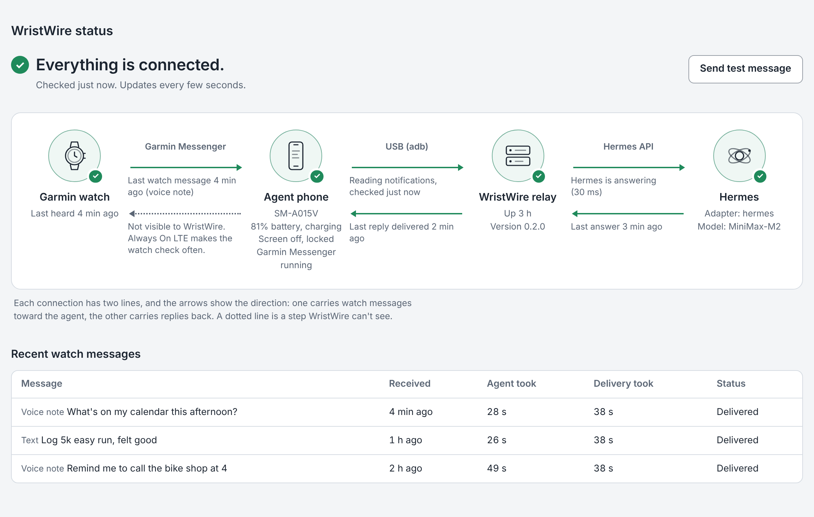
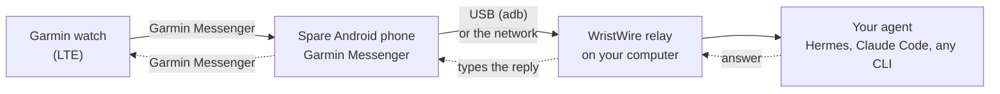

# WristWire

**Your direct line to AI. Open source, any agent, from your Garmin watch.**

Send a text or a 30-second voice note from your Garmin watch. An AI agent works on it, and the answer comes back to your wrist. You don't need your phone with you: the watch's own LTE and Garmin Messenger carry the message to a spare Android phone at home, and WristWire passes it to the agent on your computer.

It works with [Hermes](https://github.com/NousResearch/hermes-agent), with Claude Code, or with any agent you can run from the command line.



## How it works



1. You message the phone's Garmin Messenger account from your watch. Garmin transcribes voice notes on its side, so the phone receives text.
2. The relay reads the new notification on the phone, checks that it came from you, and decides how risky the request is (see [Safety](#safety)).
3. The agent answers. The relay types the reply into the same Garmin Messenger conversation on the phone and confirms it appeared on screen, and Garmin delivers it to your watch.

The relay is a single Python program with no dependencies beyond the standard library. It keeps a queue, an approval list and an audit trail in a local SQLite file, and it serves a live [status page](#status-page) that shows which links are working.

## What you need

| | |
|---|---|
| **Watch** | A Garmin watch that can send Garmin Messenger messages without a phone nearby: an LTE or inReach model such as the fēnix 8 Pro. Tested on a fēnix 8 Pro. |
| **Spare Android phone** | Any Android phone that runs Garmin Messenger, with its own Garmin Messenger account. It stays at home, plugged in. Tested on a Samsung Galaxy A01 (SM-A015V). |
| **Computer that stays on** | Linux, macOS, or Windows with WSL2. Python 3.10 or newer, and Android `adb` ([platform-tools](https://developer.android.com/tools/releases/platform-tools)). Under WSL2, WristWire uses Windows' `adb.exe` directly. |
| **An agent** | Hermes with its API server on, or the `claude` command (Claude Code), or any command that takes a message and prints an answer. |

## Set it up

**1. Prepare the spare phone.**
Install Garmin Messenger, sign it in with its own phone number, and turn on USB debugging (Settings → About phone → tap *Build number* seven times, then Developer options → USB debugging). Plug it into the computer and accept the *Allow USB debugging* prompt.

**2. Connect the watch and the phone.**
Message the phone's Garmin Messenger account from your watch once. On the phone, note the exact title of that conversation: it's usually your name. WristWire uses it to know which messages are yours and where to reply.

**3. Install WristWire on the computer.**

```bash
git clone https://github.com/netzlvl/wristwire.git
cd wristwire
./deploy.sh init-repo                 # installs the `wristwire` command and writes .env with fresh secrets
export PATH="$HOME/.local/bin:$PATH"
```

**4. Edit `.env`.** At minimum:

```bash
GARMIN_OWNER_NAME=Alex                # the conversation title from step 2
GARMIN_ALLOWED_SENDERS=alex           # who may talk to the agent (same title, lowercase is fine)

AGENT_ADAPTER=hermes                  # or: claude, cli
```

With Hermes, turn on its API server (`API_SERVER_ENABLED=true` in `~/.hermes/.env`). WristWire reads Hermes's `API_SERVER_KEY` from that same file, so you don't need to copy it.

Every setting is listed in [docs/configuration.md](docs/configuration.md).

**5. Check and start.**

```bash
wristwire doctor          # config, adb, phone, agent
wristwire adb-bridge      # runs the relay with the USB phone link
```

To keep it running in the background (and start it again after a reboot), install it as a service. Stop the `adb-bridge` you started above with Ctrl+C first, then run this from the `wristwire` folder:

```bash
./deploy.sh install-service
```

It checks the service started and tells you where the log is.

**6. Try it.** Run `wristwire dashboard` and open the link it prints. Press **Send test message** to check the path back to your watch, then send something from the watch, such as "What's on my calendar today?"

## Status page

The status page shows the four pieces (watch, phone, relay, agent) and the link between each pair. Each link has two lines: one for watch messages travelling toward the agent and one for replies coming back. A line is solid when it's working, crossed out when it's broken, and dotted for the one step WristWire can't observe: Garmin handing the reply to your watch. When something is wrong, the page says what to do about it, for example *"A draft is stuck in Garmin Messenger's message box. Clear it by hand on the phone."* Below that it lists recent messages with how long the agent and the delivery took.

There are two ways to open it:

- **In Hermes:** the plugin adds a **WristWire** tab to the Hermes dashboard (see below).
- **Without Hermes:** `wristwire dashboard` prints a link to the page the relay serves at `http://127.0.0.1:8788/status`. The link carries a one-time sign-in code that works once and expires after five minutes, so the copy left in your browser history can't be reused. The admin key itself never goes into a URL.

## Hermes plugin

The `plugin/` folder is a Hermes plugin. It gives Hermes three tools: `watch_send` to message your watch, `watch_inbox` to read what you sent, and `watch_status` for relay health. It also adds the WristWire tab to the dashboard.

```bash
ln -sfn "$PWD/plugin" ~/.hermes/plugins/wristwire    # from your clone
hermes plugins enable wristwire
```

Restart the Hermes gateway and dashboard. WristWire then appears under **Plugins** and as its own tab. When the repository is public you can also install it with `hermes plugins install https://github.com/netzlvl/wristwire/tree/main/plugin --enable`. More detail is in [plugin/README.md](plugin/README.md).

## Agents

| `AGENT_ADAPTER` | What runs | Notes |
|---|---|---|
| `hermes` (default) | Hermes `/v1/runs` | Tools, memory, and approvals that can pause mid-run. A fresh Hermes session each day keeps runs quick. |
| `claude` | `claude -p` (Claude Code) | Resumes one conversation per sender. Read-only tools by default (`Read,Grep,Glob`). |
| `cli` | Any command, e.g. `AGENT_CLI_COMMAND='ollama run llama3 {message}'` | Whatever the command prints is the reply. |

Adding another agent is one small class in [`wristwire_adapters.py`](wristwire_adapters.py). It doesn't touch the queue, the safety rules or the phone link.

## Safety

- **Only you.** Messages from anyone not in `GARMIN_ALLOWED_SENDERS` are ignored.
- **Three tiers.** Questions and notes run right away. Calendar, task and smart-home changes run and are logged. Requests that send messages to other people, spend money, delete things or touch network and security settings wait for an approval code.
- **Approval codes are bound to one request.** The watch shows a 6-character code. Reply `approve CODE` or `deny CODE`. A bare "yes" or "approve" is rejected, and codes expire after 15 minutes.
- **Watch commands.** `status` reports on the relay, and `cancel` stops the current run.
- **Kill switch.** `POST /v1/garmin/control/killswitch` with `{"enabled": true}` stops anything from reaching the agent.
- **Locked to your machine.** The relay listens on `127.0.0.1` by default. It refuses to start without a real admin key, never accepts the example keys shipped in this repository, and only answers requests addressed to its own host name, which stops malicious web pages from reaching it through your browser.
- Mid-run approval only works where the agent can pause (Hermes). A headless `claude -p` can't stop to ask, so it is limited by `AGENT_CLI_ALLOWED_TOOLS` instead.

Report vulnerabilities privately; see [SECURITY.md](SECURITY.md).

## Speed

Most of the wait between a watch message and its answer is delivery, not the agent. Typing a reply into Garmin Messenger takes the phone tens of seconds. To keep it short:

- Turn off Android animations on the spare phone, since screen reads wait for the screen to settle:
  ```bash
  adb shell settings put global window_animation_scale 0
  adb shell settings put global transition_animation_scale 0
  adb shell settings put global animator_duration_scale 0
  ```
- On the watch, set LTE to **Always On**. In Auto mode it only checks for replies when you open Messenger.
- The "Working on it..." note is off by default because it costs one full delivery before the answer. Turn it on with `GARMIN_ACK_AFTER_SECONDS=20`.

## Limits

- One owner and one conversation per relay.
- The phone has to stay plugged in and signed in to Garmin Messenger. Replying by driving the phone's screen can be interrupted by someone using the phone, and [docs/troubleshooting.md](docs/troubleshooting.md) explains each failure the status page can show.
- [`android/GarminBridgeService.kt`](android/GarminBridgeService.kt) is reference code for a phone app that would reply straight from the notification without touching the screen. It is not a packaged app yet. Tasker can use the same HTTP endpoints today.
- Garmin's network decides how fast messages reach the watch. WristWire can't see that step.

## More

- [How it works in detail](docs/how-it-works.md)
- [Configuration](docs/configuration.md)
- [Troubleshooting](docs/troubleshooting.md)

Run the tests with `python3 -m unittest test_wristwire`. Issues and pull requests are welcome.

## License

MIT; see [LICENSE](LICENSE). WristWire is not affiliated with Garmin. Garmin, fēnix, inReach and Garmin Messenger are trademarks of Garmin Ltd.
