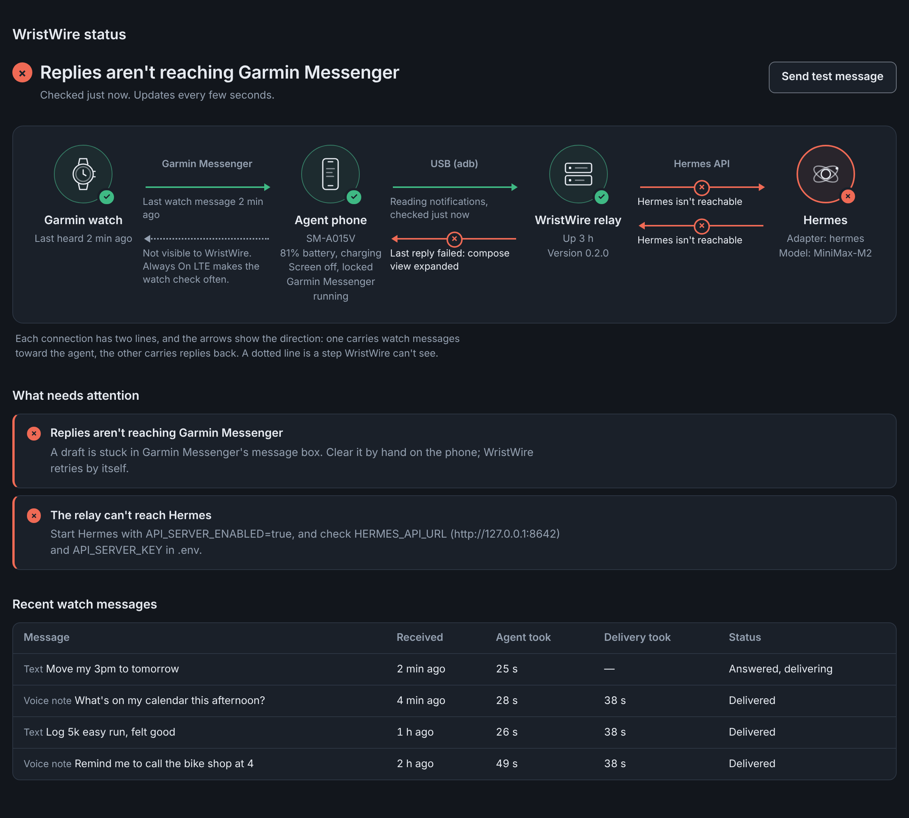

# Troubleshooting

Start with the status page (`wristwire dashboard`, or the WristWire tab in Hermes). It names the broken link and the fix. This page explains the messages it can show and the phone quirks behind them.

## The relay won't start

| Message | What to do |
|---|---|
| GARMIN_RELAY_ADMIN_KEY is missing or still the example value | Run `wristwire init` (or `./deploy.sh init-repo`) to write a `.env` with fresh secrets. |
| A request returns `host_not_allowed` | Something reached the relay by a host name it doesn't know. Add that name to `GARMIN_RELAY_ALLOWED_HOSTS`. |
| The status page says the sign-in link was used or expired | Links from `wristwire dashboard` work once, for five minutes. Run it again. |

## The phone link

| Status page says | What to do |
|---|---|
| No phone on USB | Plug the phone in with a data cable (some cables only charge) and turn on USB debugging. |
| Phone hasn't allowed USB debugging | Unlock the phone and accept the *Allow USB debugging* prompt. Tick *Always allow* so it survives reboots. |
| Phone shows as offline on USB | Unplug and replug. Under WSL2, restarting `adb.exe kill-server` on the Windows side also helps. |
| adb isn't installed | Install Android platform-tools, or set `GARMIN_ADB_BIN`. |
| Garmin Messenger isn't running on the phone | Open Garmin Messenger once and leave it signed in. Exclude it from battery optimisation so Android doesn't stop it. |
| The phone app hasn't checked in | HTTP transport only: the phone app or Tasker profile isn't reaching the relay. Check its URL and that the relay listens on an address the phone can reach. |

## Replies that don't arrive

The relay types each reply into Garmin Messenger and then checks that it appeared on screen. When it can't, the delivery fails with a named reason, which the status page translates:

| Reason | Meaning and fix |
|---|---|
| `conversation_not_found:NAME` | No conversation titled `NAME` on the phone. Set `GARMIN_OWNER_NAME` to the exact title of your thread. |
| `compose_view_expanded` | A saved draft has stretched Messenger's message box to full screen, and in that state it drops typed keys. Clear the draft by hand. WristWire doesn't force-stop the app, because that fights whoever is holding the phone. |
| `message_input_not_found`, `composer_not_focused`, `text_not_entered` | Something covered the message box: a pop-up, the attachment menu, or the keyboard. Close it on the phone. Keys go to whatever window has focus, not to the box you can see. |
| `send_not_confirmed` | Send was tapped but the reply didn't appear in the thread. Look at the thread on the phone. |

Each reply is tried up to three times in total, with a pause after each failure.

## Things that look wrong but aren't

- **The watch shows a reply late.** WristWire hands the reply to Garmin Messenger on the phone; Garmin delivers it to the watch. In the watch's Auto LTE mode it only checks for messages when you open Messenger. Use Always On.
- **The watch-side line on the status page is dotted.** That step happens inside Garmin's network and on the watch, where WristWire can't see it.
- **The watch link says "Waiting for traffic".** Nothing has been sent from the watch since the relay started using this database. Send a message.

## Quirks the code already handles

These are here so nobody has to rediscover them:

- **Unlocking.** `wm dismiss-keyguard` alone leaves some phones on the lock screen, and taps then land on it while reporting success. The relay swipes up and checks again.
- **Typing.** `adb shell input text` passes its text through two shells, so quotes and brackets in a reply broke it. Replies are typed through one quoted script line instead.
- **Notifications.** `dumpsys notification` nests unrelated records inside others, which once surfaced "USB for file transfer" as a watch message. Only records whose own header names Garmin Messenger count, and call-state notifications are ignored.
- **systemd.** User services start with a very short `PATH`, so `adb`, `hermes` or `claude` can go missing. The unit sets `PATH`; a full path in `GARMIN_ADB_BIN` or `AGENT_CLI_BINARY` is safest.
- **Config location.** The relay reads the `.env` beside its own code, not the folder it was started from, so systemd and a terminal see the same settings.
- **Approvals.** Hermes can stop mid-run and ask for approval, which reaches you as a code on the watch. A headless `claude -p` can't, so its reach is limited by `AGENT_CLI_ALLOWED_TOOLS` and the relay's own tier check instead.

## Logs

- The systemd service writes to `~/.local/state/wristwire/relay.log`. `systemctl --user status wristwire` shows whether it's running.
- Every message is in the `audit_events` table, and every reply in `outbound_replies`, with its attempts and last error.
- `wristwire doctor` prints the resolved config, the `adb` binary, the attached phone and the agent check.
